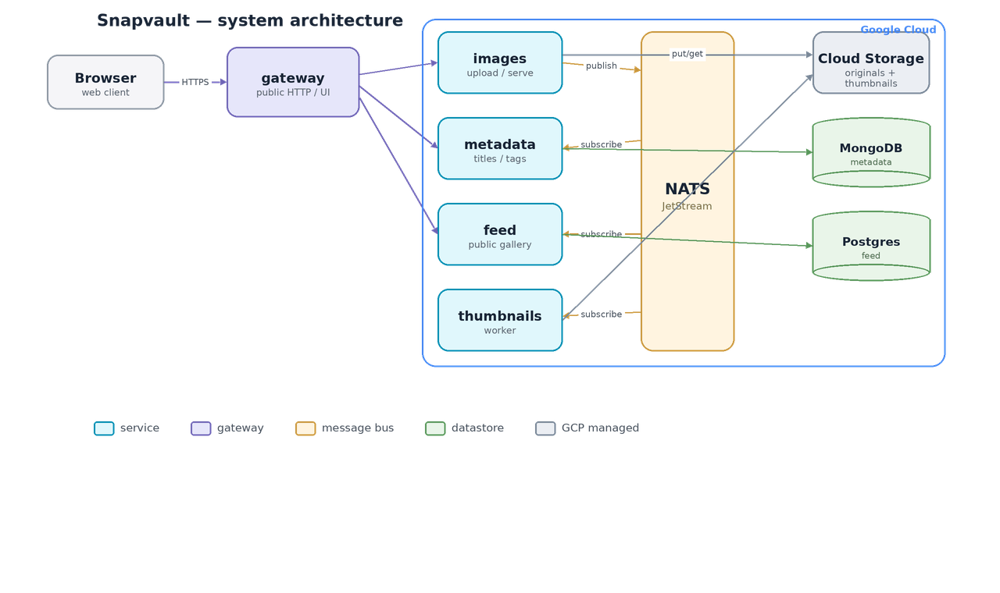

# About This Book

There is a particular kind of fear that grips a developer the first time someone says the word *microservices* in a planning meeting. You picture a wall of services, a tangle of network calls, a deployment pipeline held together with hope, and a 2 a.m. page asking why the thumbnail service can't talk to the message broker. The word has acquired a reputation for complexity that is, frankly, mostly deserved --- but only when teams adopt the architecture without first learning the handful of techniques that make it tractable.

This book exists to remove that fear by doing the only thing that reliably works: building a real system, one service at a time, from an empty folder to a cluster running in the cloud. By the end you will have written a complete photo-sharing platform as a set of independent Go services, wired them together with asynchronous messaging, given each one its own database, tested them, packaged them in containers, set up automated builds, and deployed the whole thing to Kubernetes on Google Cloud --- with logs, metrics, and traces flowing into one place so you can actually see what your system is doing.

Everything here is hands-on. Each chapter adds working code, and the code in one chapter is the foundation for the next. You are not asked to take anything on faith. When a chapter introduces Docker, you build and run a container. When it introduces NATS, you publish and consume a real message. When it introduces Kubernetes, you `kubectl apply` a manifest and watch pods come up.

## What you will build: Snapvault

Our running example is **Snapvault**, a small but realistic photo-sharing service. Users upload photos; the system stores the originals, generates thumbnails in the background, records metadata such as file type, size, and tags, and serves a public feed of recent uploads. It is deliberately the kind of application that *forces* you to confront every interesting problem in distributed systems:

-   It handles **large binary uploads**, so it needs object storage rather than a database column.
-   It does **slow background work** (thumbnailing), so it needs asynchronous messaging rather than blocking HTTP calls.
-   It has **distinct data shapes** --- document-like metadata and a query-optimized feed --- so it naturally wants more than one kind of database.
-   It must **scale unevenly**: a burst of uploads should let the thumbnail workers scale out without touching the rest of the system.

Snapvault ends up as five small services --- a public **gateway**, an **images** service, a **thumbnails** worker, a **metadata** service, and a **feed** service --- connected by a **NATS** message bus and backed by **Google Cloud Storage**, **MongoDB**, and **PostgreSQL**.

## The stack, and why

  --------------------------------------------------------------------------------------------------------------------------------------------------------------------------------------------------------------------------------------------------------
  Concern                 Tool                        Why it earns its place
  ----------------------- --------------------------- ----------------------------------------------------------------------------------------------------------------------------------------------------------------------------------------------------
  Language                **Go 1.26**                 Small static binaries, fast startup, first-class concurrency, and a standard library that already covers HTTP, JSON, and TLS --- ideal for services that must boot quickly and scale horizontally.

  Messaging               **NATS** (with JetStream)   A single small binary that gives you both fire-and-forget pub/sub and durable, replayable streams, with an operational footprint a fraction of heavier brokers.

  Cloud                   **Google Cloud**            Object storage, a managed Kubernetes platform (GKE Autopilot) that bills per pod, a container registry, and a unified observability suite that Go instruments cleanly.

  Packaging               **Docker**                  The unit of deployment; multi-stage builds turn Go source into tiny, secure images.

  Orchestration           **Kubernetes**              Declarative deployment, self-healing, and scaling --- the production home for our containers.

  Charts                  **Helm**                    The cluster's package manager --- bundling the manifests into one versioned chart that installs, upgrades, and rolls back as a unit.

  Infrastructure          **Terraform**               The cloud itself, described as code you can review and re-create.

  Identity                **Identity Platform**       Signs users in and issues standard OIDC tokens the gateway verifies, so Snapvault never stores a password.
  --------------------------------------------------------------------------------------------------------------------------------------------------------------------------------------------------------------------------------------------------------

You do not need prior experience with any of these except a working knowledge of Go (you should be comfortable with structs, interfaces, goroutines, and modules). Everything else is taught from first principles as you need it.

## How to read this book

Read it in order, with a terminal open. The chapters form a single arc:

1.  **Why microservices, and why Go** --- the trade-offs, honestly assessed.
2.  **Your first Go microservice** --- one HTTP service, done well.
3.  **Containerizing with Docker** --- turning that service into an image.
4.  **Running a system with Docker Compose** --- many services on your laptop.
5.  **Giving services their own data** --- MongoDB and PostgreSQL, one per service.
6.  **Asynchronous messaging with NATS** --- the heart of the system.
7.  **Testing microservices** --- unit, integration, and end-to-end.
8.  **Continuous integration and delivery** --- automated builds and image publishing.
9.  **Orchestration with Kubernetes on GKE** --- going to a real cluster.
10. **Packaging with Helm** --- charts, releases, and reusable deployments.
11. **Infrastructure as code with Terraform** --- the cloud, reproducibly.
12. **GitOps with ArgoCD** --- Git as the source of truth for what's deployed.
13. **Observability** --- logs, metrics, and traces.
14. **Going to production** --- scaling, secrets, resilience, and user authentication.

An appendix collects the commands and snippets you will reach for most often.

## Conventions

Shell commands are shown with a `$` prompt; do not type the `$`. Long file paths within the Snapvault repository are written relative to the repository root, for example `services/images/main.go`. Where a code listing replaces or extends an earlier one, the surrounding prose says so.

Three kinds of asides appear throughout:

::: note
**Note** --- background or context that deepens your understanding but is not required to proceed.
:::

::: tip
**Tip** --- a practical shortcut or a habit worth forming.
:::

::: warning
**Warning** --- a mistake that will cost you time, or a footgun to avoid in production.
:::

A note on versions: Go 1.26 was released in February 2026, and the code targets it directly. The cloud and library commands reflect their state at the time of writing; vendors change console layouts and flag names more often than anyone would like, so treat exact UI steps as a guide and the underlying concepts as the durable part.

Let's build something.
