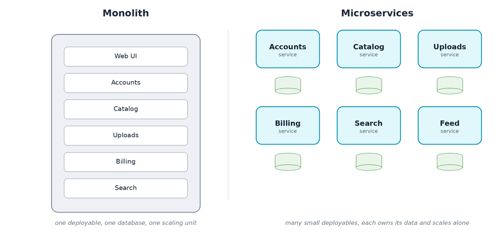

# Chapter 1 --- Why Microservices, and Why Go

Before you write a single line of Snapvault, you deserve an honest answer to a question that too many architecture diagrams skip: *should you be doing this at all?* Microservices are a tool, not a virtue. They solve specific problems and create others, and the engineers who succeed with them are the ones who understand both sides of that trade before they commit.

This chapter makes the case --- and the counter-case. Then it explains why Go, specifically, is such a comfortable language for this style of system, and sets up the tooling you'll install in Chapter 2.

## What a microservice actually is

A **microservice** is a small, independently deployable program that owns one capability of a larger system and communicates with the rest of the system only over the network --- never by reaching into another service's memory or database. That definition is doing a lot of work, so let's unpack the load-bearing words.

*Small* is about scope, not lines of code. A service is small when one person can hold its entire responsibility in their head: "this service stores and serves photos," "this service generates thumbnails." If you find yourself describing a service with the word "and" more than once, it is probably two services.

*Independently deployable* is the property that makes the whole thing worthwhile. You can ship a fix to the thumbnail service at 3 p.m. on a Tuesday without redeploying --- or even restarting --- the service that handles uploads. This is the difference that justifies all the extra moving parts. If your services must be deployed together, you have a distributed monolith, which combines the operational pain of microservices with the coupling of a monolith and is the worst of both worlds.

*Owns one capability* means each service has a clear boundary drawn around a piece of business functionality, and it owns the data behind that capability. No other service reads or writes its database directly. If the feed service wants to know an image's title, it does not run a query against the metadata service's MongoDB; it asks over the network, or it listens for events and keeps its own copy.

## The case for microservices

Three forces push teams toward this architecture. Each is real.

**Independent deployment and team autonomy.** In a monolith, every change rides the same release train. Ten teams committing to one codebase means ten teams coordinating one deployment, and the slowest, riskiest change sets the pace for everyone. Splitting the system lets each team own a service end to end and ship on its own schedule. The coordination cost that grows quadratically with team size in a monolith becomes roughly linear.

**Independent scaling.** Different parts of a system have wildly different load profiles. Snapvault's thumbnail generation is CPU-bound and bursty --- a hundred uploads in a minute creates a hundred images to resize --- while the feed is read-heavy and steady. In a monolith you scale the entire application to meet the demand of its hungriest component, paying for idle capacity everywhere else. With separate services you run three thumbnail workers and one feed instance, and adjust each independently.

**Fault isolation.** When the thumbnail worker crashes in a monolith, it can take the whole process --- and therefore uploads, the feed, and everything else --- down with it. When it crashes as its own service, uploads keep working; thumbnails simply queue up until the worker is back. A well-designed microservices system degrades in pieces instead of failing all at once.

**Technology flexibility.** Because services share nothing but network contracts, one can use MongoDB while another uses PostgreSQL, and a future service could be written in a different language entirely. You are free to choose the right tool per capability rather than the lowest common denominator for the whole system. (This is a genuine benefit, but spend it carefully --- every new technology is another thing your team must operate at 2 a.m.)

## The case against (read this twice)

Everything above is true, and none of it is free.

::: warning
**Microservices replace simple problems with hard ones.** A function call that either returns or throws becomes a network call that can also time out, return slowly, arrive twice, or vanish. A database transaction that spans three tables becomes a workflow that spans three services with no shared transaction at all. You trade compile-time guarantees for runtime hope.
:::

Be honest about these costs before you adopt the style:

-   **The network is not reliable, fast, or free.** Calls between services fail in ways function calls never do. You must design for timeouts, retries, and partial failure from day one --- Chapter 14 covers the patterns.
-   **There are no distributed transactions in practice.** You cannot atomically update the images database and the feed database. You will reach for *eventual consistency* and event-driven updates instead, which are powerful but require a shift in thinking (Chapter 6).
-   **Operations get harder.** One process becomes a dozen. You need container orchestration (Chapter 9), centralized logging and tracing (Chapter 13), and automated deployment (Chapter 8) just to keep your footing. A monolith needs almost none of this.
-   **Local development is more involved.** Running the whole system on your laptop means running every service plus its databases and a message broker. Chapter 4's Docker Compose setup exists precisely to tame this.

Here is the rule worth tattooing somewhere visible: **most systems should start as a well-structured monolith.** A modular monolith with clean internal boundaries gives you most of the benefits of microservices --- clear ownership, separation of concerns --- with none of the distributed-systems tax. Split out a service only when you feel a concrete, present pain: a component that needs to scale independently, a team that needs to deploy independently, or a fault domain you need to isolate. Splitting *speculatively*, before that pain exists, is how teams end up with the complexity of microservices and none of the payoff.

We're building Snapvault *as* microservices because this is a book about learning the techniques, and the best way to learn them is to use them on a system small enough to understand whole. In your real work, let the pain lead.

::: note
**A quick taxonomy.** When two services talk *synchronously*, the caller sends a request and waits for a response --- like an HTTP call. When they talk *asynchronously*, the sender emits a message and moves on; the receiver processes it whenever it can. Synchronous communication is simple to reason about but couples the caller's fate to the callee's availability. Asynchronous communication decouples them at the cost of more moving parts. Mature systems use both deliberately, and most of Snapvault's interesting behavior is asynchronous, flowing over NATS.
:::

## Why Go

You could build microservices in almost any language. Several properties make Go an unusually good fit, and they compound when you have many small services rather than one big one.

**Tiny, static binaries.** A Go program compiles to a single self-contained executable with no runtime to install and no dependency tree to resolve on the target machine. This is transformative for containers: a Go service image can be a handful of megabytes containing nothing but your binary, instead of hundreds of megabytes of language runtime and OS packages. Smaller images push faster, pull faster, start faster, and present a far smaller attack surface --- all of which matter more, not less, as the number of services grows. Chapter 3 builds images this way.

**Fast startup.** A Go binary is running and serving requests in milliseconds. There is no JIT warm-up and no interpreter to spin up. In a Kubernetes world where the orchestrator constantly starts, stops, and reschedules your containers --- to scale, to roll out a new version, to recover from a node failure --- startup time is not a micro-optimization. It is the difference between a responsive autoscaler and a sluggish one.

**Concurrency that fits the problem.** A network service is, at its core, a program that does many things at once: handling thousands of simultaneous connections, talking to a database, publishing to a message bus. Go's goroutines and channels make this natural. A goroutine costs a couple of kilobytes, so spawning one per request or per message is entirely reasonable, and the `context` package gives you a clean, idiomatic way to thread cancellation and deadlines through all of it --- which is exactly what you need to make those unreliable network calls safe.

**A standard library that already speaks cloud.** Out of the box, with nothing imported, Go gives you a production-grade HTTP server and client, JSON encoding, TLS, and --- since recent versions --- structured logging via `log/slog`. You will lean on a few external libraries (a NATS client, database drivers, the Google Cloud SDK), but the core of every Snapvault service is standard-library Go.

### What Go 1.27 brings to the table

We target Go 1.27 (released August 2026). Snapvault's code doesn't depend on any 1.27-only feature, but a few recent changes are worth knowing about for services like ours:

-   **`encoding/json` now runs on a new, faster implementation.** The package keeps its API and behavior (only the exact text of some error messages differs), but unmarshaling is significantly faster. Every Snapvault service decodes JSON, so every one benefits simply by building with 1.27. The new implementation is also published as `encoding/json/v2`, with stricter defaults --- it rejects invalid UTF-8 and duplicate object keys --- for code that wants them.
-   **The Green Tea garbage collector,** on by default since Go 1.26, reduces GC overhead for the allocation-heavy, many-small-objects workload a JSON-slinging service produces. Go 1.27 adds size-specialized allocation routines that make small allocations cheaper still.
-   **The goroutine-leak profile is now generally available.** It flags goroutines blocked forever on a channel or lock --- a category of bug that distributed Go systems produce with depressing regularity --- and it's served at `/debug/pprof/goroutineleak` by `net/http/pprof`.
-   **Methods can now declare their own type parameters.** Generic helpers can live on the type they belong to instead of floating at package level.

None of these are load-bearing for the architecture; they're quality-of-life improvements. The patterns in this book work on Go 1.22+ (the first release with method-and-path routing in `http.ServeMux`); we target 1.27 to stay current.

## The shape of the journey

By the final chapter, Snapvault will run as containers in a GKE cluster you provisioned with Terraform, deployed automatically whenever you push to `main`, emitting structured logs and distributed traces you can read in the Google Cloud console. We get there by adding one capability at a time and never moving on until what we have actually works.

The next chapter starts where every system does: with one service, a single HTTP endpoint, and the discipline to build it well --- because the habits you form on service number one are the habits you'll have on service number fifteen.

### Summary

-   A microservice is a small, independently deployable program that owns one capability and its data, and talks to the rest of the system only over the network.
-   The architecture buys you independent deployment, independent scaling, and fault isolation --- and charges you network unreliability, the loss of distributed transactions, and significant operational complexity.
-   Most systems should begin as a modular monolith and split out services only in response to concrete pain, not speculatively.
-   Go suits microservices through tiny static binaries, fast startup, lightweight concurrency, and a cloud-ready standard library; Go 1.27 sharpens several of these edges.
-   We build Snapvault as microservices to *learn* the techniques on a system small enough to grasp completely.
