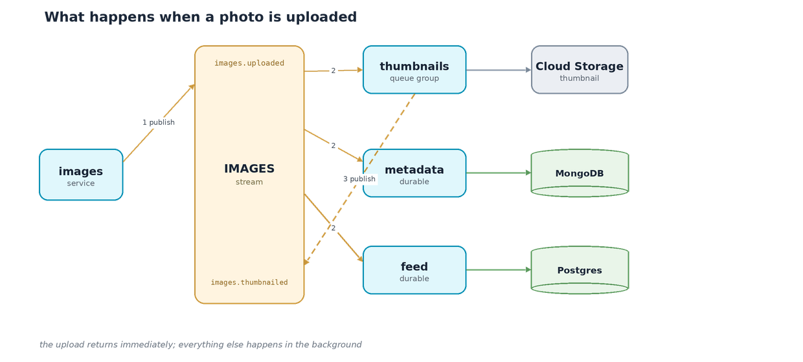

# Chapter 6 --- Asynchronous Messaging with NATS

Everything so far has been preparation for this chapter. We have services that own their data, but they are islands: an upload lands in object storage and nothing else in the system reacts. The instinct of a developer coming from monoliths is to fix this with direct calls --- have the images service call the thumbnails service, then the metadata service, then the feed service. Resist that instinct. It rebuilds the monolith over HTTP: the upload now fails if *any* downstream service is down, takes as long as the slowest one, and couples every service to the existence and address of every other. Instead we connect Snapvault with **asynchronous messaging** through **NATS**. The images service announces "an image was uploaded" and moves on; whoever cares reacts in their own time. This is the architectural heart of the system, and the rest of the book builds on it.

## Commands, events, and why async wins

There are two fundamentally different things a service can send. A **command** says *do this* --- it is addressed to a specific handler and usually expects a result ("resize this image"). An **event** says *this happened* --- it is a statement of fact, addressed to no one in particular, and the publisher neither knows nor cares who listens ("an image was uploaded"). Snapvault is built almost entirely on events, and that choice is what decouples it.

When the images service finishes storing an upload, it does not command the thumbnailer to make a thumbnail. It publishes the fact `images.uploaded` and returns success to the user immediately. Three independent services happen to be listening: the **thumbnails** worker makes a thumbnail, the **metadata** service records the details, and the **feed** service adds an entry. The images service knows about none of them. Tomorrow you can add a fourth listener --- say, a service that runs content moderation --- and not one line of the images service changes. That is the superpower: events let you add behavior by adding subscribers, not by editing publishers.

The asynchrony also fixes the failure and latency problems directly. The upload returns as soon as the original is stored and the event is published --- it does not wait for thumbnailing, which might take a second or might be retried three times. If the thumbnails worker is down when the event is published, the message waits durably until the worker comes back, and *then* the thumbnail is made. The user never sees that outage. Compare that to a direct call, where a downstream outage is an upload failure.



## NATS and JetStream in one page

NATS is a small, fast messaging system --- a single binary you can run anywhere. Plain ("core") NATS is *fire-and-forget*: a publisher sends a message on a subject, every interested subscriber connected *at that moment* receives it, and the message is then gone. That's perfect for ephemeral signals but useless for our uploads --- if the thumbnailer is restarting when an upload arrives, the work must not vanish.

That durability is what **JetStream**, NATS's persistence layer, adds. The model has three pieces:

-   A **subject** is the address a message is published to, like `images.uploaded`. Subjects are hierarchical and support wildcards: `images.>` matches every subject beginning with `images.`.
-   A **stream** is durable storage that captures messages on a set of subjects and keeps them according to a retention policy. Snapvault uses one stream, `IMAGES`, capturing `images.>`. Once a message is in the stream, it survives restarts and waits to be consumed.
-   A **consumer** is a service's cursor into a stream. A *durable* consumer remembers exactly which messages it has acknowledged, so a worker that restarts resumes precisely where it left off --- no message skipped, none silently lost.

The contract between a consumer and the stream is the **acknowledgement**. When a consumer finishes a message successfully it calls `Ack`, and only then does the stream consider that message done for that consumer. If the consumer crashes before acking, or explicitly `Nak`s (negative-acknowledges), the stream redelivers the message later. This *at-least-once* delivery is the property that makes the system reliable --- and it is also why, back in Chapter 5, we made every write idempotent: at-least-once means "possibly more than once," and an idempotent write makes a duplicate delivery harmless.

## The event contract

Before any service publishes or consumes, we need a shared definition of what the messages *are*. This is the one place in Snapvault where services share domain vocabulary, so we treat it deliberately as a published contract --- its own package, separate from the infrastructure helpers, versioned with the same care you'd give any public API. Create `internal/events/events.go`:

``` go
// Package events defines the message contracts exchanged between services.
// It is the one shared piece of domain vocabulary in Snapvault: a published
// API. Change it with the same care you'd change any interface other teams
// depend on — additively where possible.
package events

import "time"

// Stream and subject names.
const (
    StreamName         = "IMAGES"
    SubjectUploaded    = "images.uploaded"
    SubjectThumbnailed = "images.thumbnailed"
    SubjectWildcard    = "images.>" // the whole stream
)

// ImageUploaded is published by the images service after it stores an
// original. It is the trigger for all downstream work.
type ImageUploaded struct {
    ID           string    `json:"id"`
    Owner        string    `json:"owner"`
    ObjectName   string    `json:"object_name"` // key of the original in storage
    ContentType  string    `json:"content_type"`
    OriginalName string    `json:"original_name"`
    Size         int64     `json:"size"`
    UploadedAt   time.Time `json:"uploaded_at"`
}

// ImageThumbnailed is published by the thumbnails worker once a thumbnail
// exists in storage.
type ImageThumbnailed struct {
    ID          string    `json:"id"`
    ThumbObject string    `json:"thumb_object"` // key of the thumbnail in storage
    Width       int       `json:"width"`
    Height      int       `json:"height"`
    CreatedAt   time.Time `json:"created_at"`
}
```

::: note
**Is this not "domain logic in a shared package," which Chapter 2 warned against?** It is the deliberate exception, and worth being explicit about. We forbid sharing *behavior* --- how an image is processed, what the feed decides to show --- because that recreates hidden coupling. But the *contract* on the wire is, by definition, shared: two services cannot exchange a message without agreeing on its shape. Putting that agreement in one typed package, separate from both the services and the transport plumbing, makes the contract visible and reviewable rather than duplicated and drifting. The discipline is to keep this package to data definitions only --- no logic, no dependencies on services --- and to evolve it additively.
:::

## Plumbing: connecting to NATS

Connecting and declaring the stream is pure infrastructure, so it lives under `internal/platform`. Create `internal/platform/messaging/natsutil/natsutil.go`:

``` go
// Package natsutil is the transport plumbing for NATS and JetStream. It knows
// how to connect and how to declare a stream; it knows nothing about images.
package natsutil

import (
    "context"
    "fmt"
    "time"

    "github.com/nats-io/nats.go"
    "github.com/nats-io/nats.go/jetstream"
)

// Connect dials NATS with reconnection enabled and returns the connection and
// a JetStream handle. Reconnecting forever means a broker restart is survived
// rather than fatal.
func Connect(url, name string) (*nats.Conn, jetstream.JetStream, error) {
    nc, err := nats.Connect(url,
        nats.Name(name),
        nats.MaxReconnects(-1),
        nats.ReconnectWait(2*time.Second),
    )
    if err != nil {
        return nil, nil, fmt.Errorf("nats connect: %w", err)
    }
    js, err := jetstream.New(nc)
    if err != nil {
        nc.Close()
        return nil, nil, fmt.Errorf("jetstream: %w", err)
    }
    return nc, js, nil
}

// EnsureStream creates or updates a stream. It is safe to call on every
// service startup; whichever service boots first declares the stream, and the
// rest are no-ops. Subjects are passed in so this stays free of domain names.
func EnsureStream(ctx context.Context, js jetstream.JetStream, name string, subjects []string) error {
    _, err := js.CreateOrUpdateStream(ctx, jetstream.StreamConfig{
        Name:      name,
        Subjects:  subjects,
        Storage:   jetstream.FileStorage,
        Retention: jetstream.LimitsPolicy,
        MaxAge:    7 * 24 * time.Hour, // keep a week of history for replay
    })
    return err
}
```

Calling `EnsureStream` from every service is intentional and safe: `CreateOrUpdateStream` is idempotent, so we don't need a separate "set up the broker" deployment step that has to run before everything else. Each service ensures the stream it needs exists, and start order stops mattering --- the same robustness-over-orchestration principle from Chapter 4.

## Shared object storage

The thumbnails worker needs to read originals and write thumbnails --- the same object storage the images service uses. Two services needing the same *infrastructure* is exactly what `internal/platform` is for, so we lift the storage code out of the images service into a shared package. Create `internal/platform/storage/storage.go`:

``` go
// Package storage is shared object-storage plumbing: local disk for
// development, Google Cloud Storage in the cloud, chosen by environment.
package storage

import (
    "context"
    "fmt"
    "io"
    "os"
    "path/filepath"

    gcs "cloud.google.com/go/storage"

    "codeberg.org/example/snapvault/internal/platform/config"
)

// Blob is read/write access to an object store, addressed by key.
type Blob interface {
    Get(ctx context.Context, key string) (io.ReadCloser, error)
    Put(ctx context.Context, key, contentType string, r io.Reader) error
}

// NewFromEnv returns a GCS store when STORAGE=gcs, otherwise a local-disk
// store under DATA_DIR — so one binary runs locally and in the cloud.
func NewFromEnv(ctx context.Context) (Blob, error) {
    if config.String("STORAGE", "disk") == "gcs" {
        client, err := gcs.NewClient(ctx)
        if err != nil {
            return nil, fmt.Errorf("gcs client: %w", err)
        }
        return &gcsBlob{client: client, bucket: config.MustString("GCS_BUCKET")}, nil
    }
    return diskBlob{base: config.String("DATA_DIR", "./data")}, nil
}

type diskBlob struct{ base string }

func (d diskBlob) Get(_ context.Context, key string) (io.ReadCloser, error) {
    return os.Open(filepath.Join(d.base, filepath.Clean("/"+key)))
}

func (d diskBlob) Put(_ context.Context, key, _ string, r io.Reader) error {
    p := filepath.Join(d.base, filepath.Clean("/"+key))
    if err := os.MkdirAll(filepath.Dir(p), 0o755); err != nil {
        return err
    }
    f, err := os.Create(p)
    if err != nil {
        return err
    }
    defer f.Close()
    _, err = io.Copy(f, r)
    return err
}

type gcsBlob struct {
    client *gcs.Client
    bucket string
}

func (s *gcsBlob) Get(ctx context.Context, key string) (io.ReadCloser, error) {
    return s.client.Bucket(s.bucket).Object(key).NewReader(ctx)
}

func (s *gcsBlob) Put(ctx context.Context, key, contentType string, r io.Reader) error {
    w := s.client.Bucket(s.bucket).Object(key).NewWriter(ctx)
    w.ContentType = contentType
    if _, err := io.Copy(w, r); err != nil {
        _ = w.Close()
        return fmt.Errorf("gcs write %q: %w", key, err)
    }
    return w.Close()
}
```

The images service now calls `storage.NewFromEnv(ctx)` instead of constructing its own store, deleting its local `store.go` and `gcs.go`. One implementation, shared as plumbing --- and the `blobStore` interface from Chapter 2 has simply moved to its permanent home.

## Publishing the upload event

With the contract and connection in place, the images service's upload handler gains one responsibility: after storing the original, announce it. The handler now closes over a `jetstream.JetStream` as well as the store, and keeps Chapter 5's size limit:

``` go
func uploadImage(blobs storage.Blob, js jetstream.JetStream, log *slog.Logger) http.HandlerFunc {
    return func(w http.ResponseWriter, r *http.Request) {
        r.Body = http.MaxBytesReader(w, r.Body, maxUploadBytes)
        if err := r.ParseMultipartForm(maxUploadBytes); err != nil {
            http.Error(w, "invalid upload", http.StatusBadRequest)
            return
        }
        file, hdr, err := r.FormFile("image")
        if err != nil {
            http.Error(w, "expected an 'image' file field", http.StatusBadRequest)
            return
        }
        defer file.Close()

        owner := r.FormValue("owner")
        if owner == "" {
            owner = "anonymous"
        }

        id := newID()
        key := "originals/" + id
        ct := hdr.Header.Get("Content-Type")
        if ct == "" {
            ct = "application/octet-stream"
        }
        if err := blobs.Put(r.Context(), key, ct, file); err != nil {
            log.Error("store upload", "id", id, "err", err)
            http.Error(w, "could not store image", http.StatusInternalServerError)
            return
        }

        evt := events.ImageUploaded{
            ID:           id,
            Owner:        owner,
            ObjectName:   key,
            ContentType:  ct,
            OriginalName: hdr.Filename,
            Size:         hdr.Size,
            UploadedAt:   time.Now().UTC(),
        }
        data, _ := json.Marshal(evt)
        if _, err := js.Publish(r.Context(), events.SubjectUploaded, data); err != nil {
            log.Error("publish uploaded", "id", id, "err", err)
            http.Error(w, "stored but not announced", http.StatusInternalServerError)
            return
        }

        w.Header().Set("Content-Type", "application/json")
        w.WriteHeader(http.StatusCreated)
        _ = json.NewEncoder(w).Encode(map[string]string{"id": id})
    }
}
```

`owner` is whatever the client sends in the form --- there is no login, so nothing stops a client from claiming to be someone else. That's acceptable for learning the architecture; Chapter 14 replaces the form field with a verified user from Identity Platform.

Publishing to a JetStream stream blocks until the broker has *persisted* the message and acknowledged it, so a successful `Publish` means the event is durably stored and will be delivered even if every consumer is currently down. The user's upload is complete and announced; the rest of the system will catch up on its own schedule.

::: warning
**The two-write problem.** This handler does two things that can fail independently: it writes the blob, then publishes the event. If the process dies between them, the original exists but no one was told --- an orphan. Truly bulletproof solutions (the *transactional outbox* pattern) record the intent to publish in the same transaction as the write and relay it afterward. For Snapvault we accept the small window and rely on it being rare and recoverable (a periodic reconciliation job could find originals with no feed entry). The lesson is to *know* where your gaps are; every distributed system has them, and pretending otherwise is how they bite.
:::

## The thumbnails worker

The worker is Snapvault's first service with no HTTP surface at all --- it exists only to consume messages and do work. It connects, declares a durable consumer filtered to `images.uploaded`, and for each message downloads the original, resizes it, uploads the thumbnail, and publishes `images.thumbnailed`. Create `services/thumbnails/main.go`:

``` go
package main

import (
    "context"
    "log/slog"
    "os"
    "os/signal"
    "syscall"
    "time"

    "github.com/nats-io/nats.go/jetstream"

    "codeberg.org/example/snapvault/internal/events"
    "codeberg.org/example/snapvault/internal/platform/config"
    svclog "codeberg.org/example/snapvault/internal/platform/log"
    "codeberg.org/example/snapvault/internal/platform/messaging/natsutil"
    "codeberg.org/example/snapvault/internal/platform/storage"
)

func main() {
    log := svclog.New("thumbnails")
    ctx := context.Background()

    blobs, err := storage.NewFromEnv(ctx)
    if err != nil {
        log.Error("storage init", "err", err)
        os.Exit(1)
    }

    nc, js, err := natsutil.Connect(config.MustString("NATS_URL"), "thumbnails")
    if err != nil {
        log.Error("nats connect", "err", err)
        os.Exit(1)
    }
    defer nc.Drain()

    if err := natsutil.EnsureStream(ctx, js,
        events.StreamName, []string{events.SubjectWildcard}); err != nil {
        log.Error("ensure stream", "err", err)
        os.Exit(1)
    }

    stream, err := js.Stream(ctx, events.StreamName)
    if err != nil {
        log.Error("open stream", "err", err)
        os.Exit(1)
    }

    cons, err := stream.CreateOrUpdateConsumer(ctx, jetstream.ConsumerConfig{
        Durable:       "thumbnailer",
        FilterSubject: events.SubjectUploaded,
        AckPolicy:     jetstream.AckExplicitPolicy,
        AckWait:       30 * time.Second,
        MaxDeliver:    5,
    })
    if err != nil {
        log.Error("create consumer", "err", err)
        os.Exit(1)
    }

    cc, err := cons.Consume(func(msg jetstream.Msg) {
        if err := handle(ctx, blobs, js, msg, log); err != nil {
            log.Error("processing failed; will retry", "err", err)
            _ = msg.Nak()
            return
        }
        _ = msg.Ack()
    })
    if err != nil {
        log.Error("start consume", "err", err)
        os.Exit(1)
    }
    defer cc.Stop()

    log.Info("thumbnails worker running")
    sigCtx, stop := signal.NotifyContext(context.Background(),
        syscall.SIGINT, syscall.SIGTERM)
    defer stop()
    <-sigCtx.Done()
    log.Info("shutdown signal received")
}
```

The consumer configuration encodes the worker's reliability policy. `AckExplicitPolicy` means a message is only done when we call `Ack`. `AckWait: 30s` means if we haven't acked within thirty seconds the broker assumes we died and redelivers. `MaxDeliver: 5` caps redelivery attempts so a permanently broken message doesn't loop forever. And because the consumer is `Durable: "thumbnailer"`, a restarted worker resumes exactly where it left off.

The durable consumer also gives us scaling for free. Run two or ten copies of the worker and they all bind to the same `thumbnailer` consumer; JetStream hands each message to exactly one of them. This is the **competing consumers** pattern: adding workers adds throughput, with no coordination code at all. Chapters 9 and 14 lean on it.

The actual image work lives in `services/thumbnails/thumbnail.go`:

``` go
package main

import (
    "bytes"
    "context"
    "encoding/json"
    "fmt"
    "image"
    _ "image/gif"  // register decoders by importing for side effects
    "image/jpeg"
    _ "image/png"
    "log/slog"
    "time"

    "golang.org/x/image/draw"

    "github.com/nats-io/nats.go/jetstream"

    "codeberg.org/example/snapvault/internal/events"
    "codeberg.org/example/snapvault/internal/platform/storage"
)

const thumbMax = 320 // longest edge, in pixels

func handle(ctx context.Context, blobs storage.Blob, js jetstream.JetStream,
    msg jetstream.Msg, log *slog.Logger) error {

    var ev events.ImageUploaded
    if err := json.Unmarshal(msg.Data(), &ev); err != nil {
        // A message we can't even parse will never succeed. Terminate it
        // (drop permanently) rather than retry forever.
        log.Error("undecodable message; terminating", "err", err)
        _ = msg.Term()
        return nil
    }

    rc, err := blobs.Get(ctx, ev.ObjectName)
    if err != nil {
        return fmt.Errorf("get original %q: %w", ev.ObjectName, err)
    }
    defer rc.Close()

    src, _, err := image.Decode(rc)
    if err != nil {
        log.Error("undecodable image; terminating", "id", ev.ID, "err", err)
        _ = msg.Term()
        return nil
    }

    dst := scaleToFit(src, thumbMax)
    var buf bytes.Buffer
    if err := jpeg.Encode(&buf, dst, &jpeg.Options{Quality: 82}); err != nil {
        return fmt.Errorf("encode thumbnail: %w", err)
    }

    thumbKey := "thumbs/" + ev.ID + ".jpg"
    if err := blobs.Put(ctx, thumbKey, "image/jpeg", &buf); err != nil {
        return fmt.Errorf("store thumbnail: %w", err)
    }

    out := events.ImageThumbnailed{
        ID:          ev.ID,
        ThumbObject: thumbKey,
        Width:       dst.Bounds().Dx(),
        Height:      dst.Bounds().Dy(),
        CreatedAt:   time.Now().UTC(),
    }
    data, _ := json.Marshal(out)
    if _, err := js.Publish(ctx, events.SubjectThumbnailed, data); err != nil {
        return fmt.Errorf("publish thumbnailed: %w", err)
    }

    log.Info("thumbnail created", "id", ev.ID, "w", out.Width, "h", out.Height)
    return nil
}

// scaleToFit returns src scaled so its longest edge is at most max,
// preserving aspect ratio. Images already small enough are returned as-is.
func scaleToFit(src image.Image, max int) image.Image {
    b := src.Bounds()
    w, h := b.Dx(), b.Dy()
    if w <= max && h <= max {
        return src
    }
    if w >= h {
        h, w = h*max/w, max
    } else {
        w, h = w*max/h, max
    }
    dst := image.NewRGBA(image.Rect(0, 0, w, h))
    draw.CatmullRom.Scale(dst, dst.Bounds(), src, b, draw.Over, nil)
    return dst
}
```

The distinction between `Nak` and `Term` is the worker's error philosophy in miniature. A *transient* failure --- storage briefly unreachable, a publish that timed out --- gets `Nak`: try again, the next attempt may succeed. A *permanent* failure --- a message that isn't valid JSON, or bytes that aren't a decodable image --- gets `Term`: retrying will never help, so drop it deliberately rather than let it consume five delivery attempts and clog the consumer. Knowing which errors are which is the difference between a worker that recovers and one that wedges.

::: tip
**Image decoding is a security boundary.** The worker decodes bytes that an untrusted user uploaded, using Go's standard image decoders. Those decoders are memory-safe, which already puts you ahead of the C libraries that have produced a long history of image-parsing exploits --- but in production you'd also cap the dimensions you'll decode (a "decompression bomb" can be tiny on disk and enormous in memory) and run this worker with tight resource limits, which Kubernetes provides in Chapter 9.
:::

## Consumers that keep data in sync

The metadata and feed services now get their data the right way: by subscribing to events, not by exposing write endpoints. The pattern is the same in both --- declare a durable consumer, react to messages, ack --- so each service runs its consumer alongside its read-only HTTP API.

The metadata service consumes `images.uploaded` and upserts a document. Its `main` starts the consumer, then runs the HTTP server (which blocks until shutdown):

``` go
cons, err := stream.CreateOrUpdateConsumer(ctx, jetstream.ConsumerConfig{
    Durable:       "metadata",
    FilterSubject: events.SubjectUploaded,
    AckPolicy:     jetstream.AckExplicitPolicy,
    AckWait:       30 * time.Second,
    MaxDeliver:    5,
})
if err != nil {
    log.Error("create consumer", "err", err)
    os.Exit(1)
}
cc, err := cons.Consume(func(msg jetstream.Msg) {
    var ev events.ImageUploaded
    if err := json.Unmarshal(msg.Data(), &ev); err != nil {
        _ = msg.Term()
        return
    }
    m := ImageMeta{
        ID:           ev.ID,
        Owner:        ev.Owner,
        ContentType:  ev.ContentType,
        OriginalName: ev.OriginalName,
        Size:         ev.Size,
        Tags:         tagsFor(ev),
        UploadedAt:   ev.UploadedAt,
    }
    if err := store.Upsert(ctx, m); err != nil {
        log.Error("upsert metadata", "id", ev.ID, "err", err)
        _ = msg.Nak()
        return
    }
    _ = msg.Ack()
})
if err != nil {
    log.Error("start consume", "err", err)
    os.Exit(1)
}
defer cc.Stop()
// ... then httpx.Serve(...) blocks, serving GET /metadata reads.
```

`tagsFor` derives a starter tag from the content type --- `jpeg`, `png`, `gif` --- so the `GET /metadata?tag=` query from Chapter 5 has something to match:

``` go
// tagsFor tags an image by its media subtype, e.g. "image/png" -> "png".
func tagsFor(ev events.ImageUploaded) []string {
    _, sub, ok := strings.Cut(ev.ContentType, "/")
    if !ok {
        return nil
    }
    sub, _, _ = strings.Cut(sub, ";")
    if sub = strings.ToLower(strings.TrimSpace(sub)); sub != "" {
        return []string{sub}
    }
    return nil
}
```

User-supplied tags would arrive the same way: a new optional field on `ImageUploaded`, filled in by the upload form. Adding a field is a backward-compatible change to the contract, which is exactly how the note above says to evolve it.

The feed service is the interesting one, because it cares about *both* events. It subscribes to the whole stream (`images.>`) and switches on the subject: an `uploaded` event adds a feed row; a `thumbnailed` event fills in the thumbnail columns. That second write raises an ordering question: what if the `thumbnailed` event is handled before the row exists? It happens more easily than you'd think. With two feed replicas (Chapter 9 runs two), the two events for one image can land on different Pods at the same moment; and if the `uploaded` write fails once and is `Nak`ed, its redelivery comes *after* the thumbnail. A plain `UPDATE` would match zero rows, report success, and the thumbnail would be acknowledged and lost for good. So `SetThumb` reports a missing row as an error of its own:

``` go
// errNoFeedItem reports that the matching images.uploaded event has not been
// applied yet.
var errNoFeedItem = errors.New("feed item does not exist yet")

func (s *feedStore) SetThumb(ctx context.Context, id, thumbObject string, w, h int) error {
    tag, err := s.pool.Exec(ctx,
        `UPDATE feed_items SET thumb_object = $2, width = $3, height = $4
         WHERE id = $1`, id, thumbObject, w, h)
    if err != nil {
        return err
    }
    if tag.RowsAffected() == 0 {
        return errNoFeedItem
    }
    return nil
}
```

Then the consumer dispatches by subject, and answers that particular error with a *delayed* `Nak`, giving the upload event time to land before the next attempt:

``` go
cons, err := stream.CreateOrUpdateConsumer(ctx, jetstream.ConsumerConfig{
    Durable:       "feed",
    FilterSubject: events.SubjectWildcard, // images.>
    AckPolicy:     jetstream.AckExplicitPolicy,
    AckWait:       30 * time.Second,
    MaxDeliver:    5,
})
if err != nil {
    log.Error("create consumer", "err", err)
    os.Exit(1)
}
cc, err := cons.Consume(func(msg jetstream.Msg) {
    switch msg.Subject() {
    case events.SubjectUploaded:
        var ev events.ImageUploaded
        if err := json.Unmarshal(msg.Data(), &ev); err != nil {
            _ = msg.Term()
            return
        }
        err := store.Add(ctx, FeedItem{
            ID: ev.ID, Owner: ev.Owner, UploadedAt: ev.UploadedAt,
        })
        ackOrNak(msg, err, log)
    case events.SubjectThumbnailed:
        var ev events.ImageThumbnailed
        if err := json.Unmarshal(msg.Data(), &ev); err != nil {
            _ = msg.Term()
            return
        }
        err := store.SetThumb(ctx, ev.ID, ev.ThumbObject, ev.Width, ev.Height)
        if errors.Is(err, errNoFeedItem) {
            _ = msg.NakWithDelay(5 * time.Second) // row not there yet; try later
            return
        }
        ackOrNak(msg, err, log)
    default:
        _ = msg.Ack() // a subject we don't handle; consume and ignore
    }
})
if err != nil {
    log.Error("start consume", "err", err)
    os.Exit(1)
}
defer cc.Stop()
```

where `ackOrNak` is the obvious helper that `Ack`s on success and `Nak`s on error. The feed stores the thumbnail's object key (`thumbs/<id>.jpg`), not a URL: how that key is served is the gateway's business, and it can change without touching a single feed row. This service is now a clean example of a **read model** built from events: it listens to what happened across the system and maintains a Postgres table shaped exactly for the one query it serves. That is the essence of the pattern often called CQRS --- the feed never queries another service to render the gallery; it has already assembled everything it needs from the event stream.

::: note
**Eventual consistency, in the flesh.** For a few moments after an upload, the feed may show the image without a thumbnail, and a thumbnail event may even arrive before the row it belongs to. Neither is an error. The delayed `Nak` above turns "arrived too early" into "applied a few seconds later," and the image is then fully in place. This is *eventual consistency*: the system is briefly not-quite-right and then becomes right, with no data lost. Notice that "no data lost" had to be *engineered*: the first, naive version of `SetThumb` silently dropped early thumbnails. Every handler in an event-driven system deserves the question "what if this arrives first?" Designing so that "briefly wrong, then correct" is acceptable --- rather than demanding "always perfectly consistent across services," which distributed systems cannot cheaply provide --- is the central mental shift of event-driven architecture.
:::

## Wiring NATS into Compose

Add the broker to `compose.yaml` and give every service its address:

``` yaml
  nats:
    image: nats:2.10
    command: ["-js", "-sd", "/data"]   # enable JetStream, persist to /data
    volumes:
      - nats-data:/data

  # add to images, thumbnails, metadata, and feed:
  #   environment:
  #     NATS_URL: nats://nats:4222

  thumbnails:
    build:
      context: .
      args: { SERVICE: thumbnails }
    environment:
      NATS_URL: nats://nats:4222
      STORAGE: disk
      DATA_DIR: /data
    volumes:
      - images-data:/data        # shares originals/thumbs with images locally
    depends_on: [nats]

volumes:
  images-data:
  mongo-data:
  pg-data:
  nats-data:
```

Locally the thumbnails worker and images service share one disk volume so both see the same `originals/` and `thumbs/` keys; in the cloud they'll share a GCS bucket instead, with no code change.

To exercise the system end to end, the gateway grows a few more routes alongside the `/images/` one from Chapter 4 --- `GET /thumbs/{name}` proxied to the images service, `POST /api/images` forwarded to the images service's `POST /images`, and `GET /api/feed` forwarded to the feed service's `GET /feed`. Each is just another `httputil.NewSingleHostReverseProxy` pointed at the right internal URL (the feed one reads a new `FEED_URL` setting, `http://feed:8080` in Compose); we'll round out the gateway with real aggregation in Chapter 14. Bring it all up with `docker compose up --build`, then watch the whole pipeline fire from a single upload:

``` bash
$ curl -F "image=@photo.jpg" -F "owner=ada" http://localhost:8080/api/images
{"id":"6f1c..."}
$ curl http://localhost:8080/api/feed
[{"id":"6f1c...","owner":"ada","thumb_object":"thumbs/6f1c....jpg","width":320,"height":240,...}]
$ curl -o thumb.jpg http://localhost:8080/thumbs/6f1c....jpg
```

In the interleaved logs you'll see the sequence play out across services: images logs the upload and publish, thumbnails logs the thumbnail it created, and both metadata and feed log their writes --- four services cooperating, none of them aware of the others, coordinated entirely by events on a stream.

### Summary

-   Connect services with **events** ("this happened"), not direct calls or commands; publishers don't know who listens, so behavior is added by adding subscribers, and one downstream outage never fails an upload.
-   **NATS JetStream** persists messages in a **stream** and tracks each service's progress with a **durable consumer**, giving at-least-once delivery that survives restarts.
-   Acknowledgements are the contract: `Ack` on success, `Nak` to retry a transient failure, `Term` to drop a permanently bad message; at-least-once is why every write was made idempotent.
-   The message **contract** lives in its own `internal/events` package --- the one shared domain vocabulary, treated as a versioned public API --- while connection and stream setup are infrastructure under `internal/platform`.
-   The feed service is a **read model**: it builds a query-shaped Postgres table purely from the event stream and never calls another service to render the gallery.
-   Distributed systems are **eventually consistent**; designing so "briefly wrong, then correct" is acceptable is the core shift that makes event-driven architecture work.

Snapvault is now a complete, working system. But "it works when I run it" is not the same as "it works" --- we have written a great deal of code and tested none of it automatically. Chapter 7 makes the system trustworthy.
