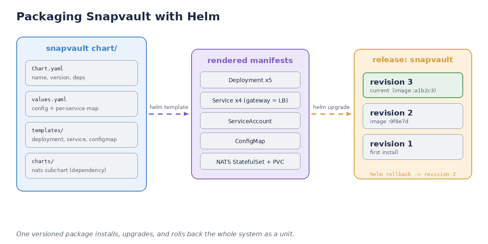

# Chapter 10 --- Packaging with Helm

Look back at what we did to put Snapvault on the cluster in Chapter 9. We wrote five Deployment manifests that are ninety percent identical --- the same probe block, the same `envFrom`, the same `resources`, the same labels --- differing only in a name, a port, and a replica count. We applied them one `kubectl apply -f` at a time. We baked the image registry and a literal commit SHA straight into the YAML, so shipping a new build meant editing those files or running `kubectl set image` by hand. And when we needed NATS, we didn't write its StatefulSet at all --- we ran a single `helm install` and got a correct, persistent, JetStream-enabled broker for free.

That last move is the tell. We already reached for a packaging tool the moment the YAML got genuinely hard, and it paid off immediately. This chapter turns Snapvault's *own* pile of manifests into the same kind of artifact: a **Helm chart** --- a single, versioned, parameterized package that installs, upgrades, and rolls back the whole system as one unit, and that can pull in NATS as a declared dependency rather than a remembered command.

It's worth saying up front where this leads. Helm is the tool we'll keep using for *other people's* software: NATS in Chapters 9, 12, and 14, and ArgoCD itself in Chapter 12. For Snapvault's *own* services, Chapter 12 deploys plain Kustomize manifests under GitOps instead, for reasons the "Helm or Kustomize?" section at the end of this chapter lays out. Building the chart is still worth the time. Every chart you install is built exactly this way, you can't judge the trade-off without having written one, and if your situation tips the other way --- you ship Snapvault to other teams, say --- this chart is what you'd deploy.



## What Helm is

Helm is the package manager for Kubernetes. If `apt` installs a `.deb` and `npm` installs a package, Helm installs a **chart** --- a bundle of templated manifests plus a default configuration --- into a cluster. Three ideas carry the whole model.

A **chart** is the package: a directory of YAML *templates* and a `Chart.yaml` describing the package itself (its name, its version, what it depends on). Templates are ordinary Kubernetes manifests with holes in them, written in Go's template language, so one `deployment.yaml` template can produce all five of Snapvault's Deployments.

**Values** are the configuration that fills those holes. A chart ships a `values.yaml` with sensible defaults; you override a subset at install time with your own values file or `--set` flags. This is the typed-ish surface between "the chart's author decided how things are wired" and "the operator decided the specifics for this environment" --- replica counts, image tags, the bucket name.

A **release** is one installed instance of a chart, with a name and a **revision history**. Every `helm install` and `helm upgrade` creates a new revision; Helm remembers them all. That history is the feature you don't get from `kubectl apply`: a bad upgrade is undone with a single `helm rollback`, and Helm puts the entire release --- every Deployment, Service, and ConfigMap together --- back to exactly how it was.

## Scaffolding a chart

Helm can generate a starting skeleton:

``` bash
$ helm create snapvault
```

This produces a `snapvault/` directory with a `Chart.yaml`, a `values.yaml`, a `templates/` folder, and a `charts/` folder for dependencies. The generated templates are a reasonable single-service example, but Snapvault has five services with one odd duck (a worker with no Service), so we'll replace most of the scaffold with templates that fit our system. Keep the structure; rewrite the contents.

    snapvault/
      Chart.yaml            # the package: name, version, dependencies
      values.yaml           # default configuration
      values-prod.yaml      # production overrides
      templates/
        _helpers.tpl        # reusable template snippets (names, labels)
        serviceaccount.yaml
        configmap.yaml
        deployment.yaml     # one template -> five Deployments
        service.yaml        # one template -> four Services
      charts/               # NATS subchart lands here after `dependency update`

## Describing the package: Chart.yaml

`Chart.yaml` is the package manifest. It carries two versions that mean different things --- the chart's own version (bump it when you change the templates) and `appVersion` (the version of Snapvault it deploys) --- and it can declare NATS as a dependency so the chart brings its own broker.

``` yaml
apiVersion: v2
name: snapvault
description: The Snapvault photo-sharing platform — five Go services on NATS.
type: application
version: 0.1.0        # the chart's version; bump on template changes
appVersion: "1.0.0"   # the Snapvault version this chart installs

dependencies:
  - name: nats
    version: "~1.2.0"   # pin to a version you have tested
    repository: https://nats-io.github.io/k8s/helm/charts/
    condition: nats.enabled
```

The `condition` makes the bundled NATS optional. We'll leave it **off** by default, because Snapvault already runs NATS as its own `nats` release from Chapter 9 and keeps it that way for the rest of the book. Bundling suits the opposite case: someone installing Snapvault from scratch who wants one command to bring up everything, broker included. Even with the dependency switched off, Helm still wants it present, so pull it down into `charts/`:

``` bash
$ helm dependency update snapvault
```

This reads the `dependencies` list, downloads the NATS chart, and writes a `Chart.lock` that pins the exact resolved version --- the Helm equivalent of a lockfile, and the reason `dependency update` is something you commit the result of.

::: warning
A chart from a public repository is software you are about to run with cluster permissions. Pin an exact version you have reviewed, prefer first-party repositories (here, NATS's own), and treat a chart bump like any other dependency upgrade --- read the diff, don't blindly take `latest`.
:::

## Reusable snippets: \_helpers.tpl

Before the manifests, define the names and labels every object will share. Files in `templates/` whose names start with an underscore aren't rendered to Kubernetes objects; they hold named templates you `include` elsewhere. This is how you stay DRY across five services.

    {{/* templates/_helpers.tpl */}}

    {{- define "snapvault.name" -}}
    {{- default .Chart.Name .Values.nameOverride | trunc 63 | trimSuffix "-" -}}
    {{- end -}}

    {{- define "snapvault.fullname" -}}
    {{- if .Values.fullnameOverride -}}
    {{- .Values.fullnameOverride | trunc 63 | trimSuffix "-" -}}
    {{- else -}}
    {{- printf "%s-%s" .Release.Name (include "snapvault.name" .) | trunc 63 | trimSuffix "-" -}}
    {{- end -}}
    {{- end -}}

    {{- define "snapvault.labels" -}}
    helm.sh/chart: {{ printf "%s-%s" .Chart.Name .Chart.Version }}
    app.kubernetes.io/name: {{ include "snapvault.name" . }}
    app.kubernetes.io/instance: {{ .Release.Name }}
    app.kubernetes.io/managed-by: {{ .Release.Service }}
    {{- end -}}

    {{- define "snapvault.selectorLabels" -}}
    app.kubernetes.io/name: {{ include "snapvault.name" . }}
    app.kubernetes.io/instance: {{ .Release.Name }}
    {{- end -}}

The `{{- ... -}}` markers trim surrounding whitespace, which matters in YAML, where indentation is structure. The standard `app.kubernetes.io/*` labels let any tool --- `kubectl`, dashboards, ArgoCD --- recognize what manages an object.

::: note
We set `fullnameOverride: snapvault` in values, so `snapvault.fullname` resolves to plain `snapvault`. That keeps the ConfigMap named `snapvault-config` and the ServiceAccount named `snapvault`, exactly as in Chapter 9. The five **Services**, though, are named by their service key --- `images`, `feed`, `gateway` --- *not* prefixed with the release name, because the gateway resolves siblings by those bare DNS names (`http://images:8080`). Naming is not cosmetic here; it's part of the contract.
:::

## The configuration surface: values.yaml

Everything that varies lives in `values.yaml`. The heart of it is a `services` map: one entry per service, ranged over by the templates. Adding a sixth service becomes a few lines of values, not a new file.

``` yaml
nameOverride: ""
fullnameOverride: snapvault

image:
  registry: us-central1-docker.pkg.dev/PROJECT_ID/snapvault
  tag: latest
  pullPolicy: IfNotPresent

# Created out of band (Chapter 9) or mounted from Secret Manager (Chapter 14).
secretName: snapvault-secrets

# Non-secret configuration, injected into every service as env vars.
config:
  NATS_URL: "nats://nats:4222"   # the standalone `nats` release from Chapter 9
  STORAGE: "gcs"
  GCS_BUCKET: "snapvault-uploads-prod"
  MONGO_DB: "snapvault"
  IMAGES_URL: "http://images:8080"
  METADATA_URL: "http://metadata:8080"
  FEED_URL: "http://feed:8080"
  LOG_LEVEL: "info"

# One entry per service. The deployment template ranges over this map.
services:
  gateway:
    replicas: 2
    port: 8080
    service: { type: LoadBalancer, port: 80 }
    resources:
      requests: { cpu: 250m, memory: 128Mi }
      limits:   { memory: 256Mi }
  images:
    replicas: 2
    port: 8080
    service: { type: ClusterIP, port: 8080 }
    resources:
      requests: { cpu: 250m, memory: 128Mi }
      limits:   { memory: 256Mi }
  metadata:
    replicas: 2
    port: 8080
    service: { type: ClusterIP, port: 8080 }
    resources:
      requests: { cpu: 250m, memory: 128Mi }
      limits:   { memory: 256Mi }
  feed:
    replicas: 2
    port: 8080
    service: { type: ClusterIP, port: 8080 }
    resources:
      requests: { cpu: 250m, memory: 128Mi }
      limits:   { memory: 256Mi }
  thumbnails:
    replicas: 1
    port: 8081          # health only; no `service:` key => no Service rendered
    resources:
      requests: { cpu: 500m, memory: 256Mi }
      limits:   { memory: 512Mi }

# Values passed through to the NATS subchart (off: NATS is its own release).
nats:
  enabled: false
  config:
    jetstream:
      enabled: true
      fileStore:
        pvc:
          size: 10Gi
```

`NATS_URL` points at `nats`, the standalone release from Chapter 9. The `nats:` block at the bottom isn't read by our templates at all; Helm hands any top-level key matching a dependency's name straight to that subchart, so this is how you'd configure the bundled broker's JetStream and volume size from our own values file. Flip `nats.enabled` to `true` and the chart renders its own broker, named after the release plus the chart --- `snapvault-nats` --- so `NATS_URL` would have to become `nats://snapvault-nats:4222` to match.

## One template, five Deployments

Here is the payoff. A single `deployment.yaml` ranges over the `services` map and emits a Deployment for each --- the repetition from Chapter 9 collapsed into one parameterized definition.

``` yaml
{{- range $name, $svc := .Values.services }}
---
apiVersion: apps/v1
kind: Deployment
metadata:
  name: {{ $name }}
  labels:
    {{- include "snapvault.labels" $ | nindent 4 }}
    app.kubernetes.io/component: {{ $name }}
spec:
  replicas: {{ $svc.replicas | default 1 }}
  selector:
    matchLabels:
      {{- include "snapvault.selectorLabels" $ | nindent 6 }}
      app.kubernetes.io/component: {{ $name }}
  template:
    metadata:
      labels:
        {{- include "snapvault.selectorLabels" $ | nindent 8 }}
        app.kubernetes.io/component: {{ $name }}
    spec:
      serviceAccountName: {{ include "snapvault.fullname" $ }}
      containers:
        - name: {{ $name }}
          image: "{{ $.Values.image.registry }}/{{ $name }}:{{ $.Values.image.tag }}"
          imagePullPolicy: {{ $.Values.image.pullPolicy }}
          ports:
            - containerPort: {{ $svc.port }}
          envFrom:
            - configMapRef:
                name: {{ include "snapvault.fullname" $ }}-config
            {{- if $.Values.secretName }}
            - secretRef:
                name: {{ $.Values.secretName }}
            {{- end }}
          readinessProbe:
            httpGet: { path: /health/ready, port: {{ $svc.port }} }
            initialDelaySeconds: 3
            periodSeconds: 5
          livenessProbe:
            httpGet: { path: /health/live, port: {{ $svc.port }} }
            initialDelaySeconds: 3
            periodSeconds: 10
          resources:
            {{- toYaml $svc.resources | nindent 12 }}
{{- end }}
```

A few mechanics earn their keep here. Inside `range`, the dot (`.`) rebinds to the current element, so we use `$name` and `$svc` for the loop variables and `$` to reach back to the root for globals like `$.Values.image`. `include "..." $` pulls in a named helper and `nindent N` re-indents its output to the right YAML depth. `toYaml $svc.resources` serializes the whole `resources` value as-is, so the structure lives in `values.yaml`, not the template. And the `{{- if $.Values.secretName }}` block makes the Secret optional for the whole chart: install it somewhere secrets arrive another way (Chapter 14 mounts them from Secret Manager) and you set `secretName: ""` instead of editing templates. It's all-or-nothing, though --- every service gets the same Secret. Chapter 9's gateway had none; here it gets one, which is harmless because it simply ignores the variables. A per-service `secret: true` flag in the `services` map would be the next refinement if that mattered.

Notice what is *not* here: the thumbnails worker gets a Deployment from this same loop, on port 8081, with no special-casing. Its difference --- having no Service --- is expressed entirely by the absence of a `service:` key in its values, which the next template respects.

## One template, four Services

The Service template ranges over the same map but renders an object only when the entry has a `service:` block --- so the worker is skipped automatically, and the gateway's `LoadBalancer` versus everyone else's `ClusterIP` is just a value.

``` yaml
{{- range $name, $svc := .Values.services }}
{{- if $svc.service }}
---
apiVersion: v1
kind: Service
metadata:
  name: {{ $name }}
  labels:
    {{- include "snapvault.labels" $ | nindent 4 }}
    app.kubernetes.io/component: {{ $name }}
spec:
  type: {{ $svc.service.type | default "ClusterIP" }}
  selector:
    {{- include "snapvault.selectorLabels" $ | nindent 4 }}
    app.kubernetes.io/component: {{ $name }}
  ports:
    - port: {{ $svc.service.port }}
      targetPort: {{ $svc.port }}
{{- end }}
{{- end }}
```

The `configmap.yaml` and `serviceaccount.yaml` templates are short --- the ConfigMap renders `.Values.config` with `toYaml`, and the ServiceAccount is a few lines named by `snapvault.fullname`. With those in place, the chart is complete.

## Rendering before you install

Never install a chart you haven't looked at rendered. `helm template` runs the templates locally and prints the YAML Helm *would* apply, with no cluster involved --- the fastest way to catch an indentation slip or a missing value:

``` bash
$ helm template snapvault ./snapvault | less
```

`helm lint` checks the chart for structural problems, and a dry run validates the rendered objects against the live cluster's API without creating anything:

``` bash
$ helm lint ./snapvault
$ helm install snapvault ./snapvault --namespace snapvault --dry-run --debug
```

Only when that looks right do you install for real.

## Install, upgrade, roll back

Installing creates release **revision 1**:

``` bash
$ helm install snapvault ./snapvault --namespace snapvault --create-namespace
```

Helm applies every object --- ServiceAccount, ConfigMap, five Deployments, four Services, plus the NATS subchart's StatefulSet and volume if you enabled it --- and records the result as one release. In day-to-day use you don't run `install` and `upgrade` separately; `upgrade --install` does the right thing whether or not the release exists, which is exactly what a CI pipeline wants:

``` bash
$ helm upgrade --install snapvault ./snapvault \
    --namespace snapvault \
    -f ./snapvault/values-prod.yaml \
    --set image.tag="$GIT_SHA"
```

Each upgrade is a new revision. List them, and the model becomes concrete:

``` bash
$ helm history snapvault
REVISION  STATUS      CHART            APP VERSION  DESCRIPTION
1         superseded  snapvault-0.1.0  1.0.0        Install complete
2         superseded  snapvault-0.1.0  1.0.0        Upgrade complete
3         deployed    snapvault-0.1.0  1.0.0        Upgrade complete
```

If revision 3 is bad, one command restores the entire previous release --- all five services together, plus their config --- not just one Deployment:

``` bash
$ helm rollback snapvault 2
```

This is the difference from `kubectl rollout undo`, which reverts a *single* Deployment. A release rolls back as a whole, which is what you want when a deploy changed the gateway, a ConfigMap, and the feed service at once. To tear the whole thing down --- every object the release owns --- `helm uninstall snapvault`.

## Per-environment configuration

The default `values.yaml` is the development shape. Production differences go in a separate file you layer on top; Helm merges it over the defaults, so you only state what changes.

``` yaml
# values-prod.yaml
image:
  registry: us-central1-docker.pkg.dev/acme-prod/snapvault
  tag: ""                      # supplied by CI via --set image.tag=$GIT_SHA

config:
  GCS_BUCKET: "snapvault-uploads-prod"

services:
  thumbnails:
    replicas: 3                # more workers for the upload surge
```

Helm merges maps key by key, so this file changes the registry, the bucket, and one replica count, and inherits everything else --- including `nats.enabled: false` and the `nats://nats:4222` address. The same chart, two environments, one small overlay file --- and the commit SHA stays out of the file, injected by the pipeline at deploy time.

## Helm or Kustomize?

You now know two ways to package Snapvault: the plain manifests from Chapter 9, and this chart. The plain manifests grow into the third option once you need per-environment differences: **Kustomize**, which Chapter 12 uses. They solve overlapping problems with different philosophies, and it's worth being honest about the trade-off rather than declaring a winner.

**Kustomize** never templates. You write real, valid Kubernetes YAML --- the base --- and describe changes as *patches* layered in overlays. There is no templating language to learn or misindent, and it's built into `kubectl` (`kubectl apply -k`). It shines when your variation is "the same manifests, with a few fields different per environment," and it keeps the manifests readable as plain YAML the whole way through.

**Helm** templates, packages, and versions. A chart is a distributable artifact you can publish to a repository and others can install; values give a deliberate configuration surface; dependencies pull in other charts (our NATS); and the release lifecycle --- `history`, `rollback`, atomic upgrades --- is something Kustomize simply doesn't have. The price is the Go template language, which grows hairy as logic creeps into your YAML.

A reasonable rule: reach for **Helm when you're distributing software or composing third-party charts**, and for **Kustomize when you're deploying your own app with modest per-environment differences** --- especially under GitOps, where plain, reviewable YAML is a virtue. Plenty of teams use both: Helm to install dependencies like NATS and ArgoCD, Kustomize for their own services. You can even render a chart and then patch it (`helm template | kubectl apply -k`), getting Helm's packaging and Kustomize's last-mile patching.

::: tip
Resist the urge to template everything. The best charts keep logic shallow: a values map, a few `if`s for optional pieces, and `toYaml` to hand structured values straight through. Every `{{ if }}` you add is a branch someone has to render in their head to know what the cluster will get. When a template starts to look like a program, that's a sign the variation belongs in Kustomize, or in two charts, not in more conditionals.
:::

## Helm under GitOps

In Chapter 12 we hand continuous deployment to ArgoCD, and Helm fits that two ways. ArgoCD can consume a chart directly --- an `Application` points at the chart's location, a `targetRevision`, and a list of values files or parameters, and ArgoCD renders and syncs it. Or you can render the chart to plain YAML in CI (`helm template`) and commit the result to the config repository, so what Git holds is the exact, fully-expanded manifest set --- the "rendered manifests" pattern, prized for leaving nothing to interpret at deploy time. Both are common. Following this chapter's own rule --- our own app, modest per-environment differences, GitOps --- Chapter 12 deploys Snapvault's services as a Kustomize overlay, and uses the direct-chart style for the third-party NATS chart.

### Summary

-   Helm is the **package manager for Kubernetes**: a **chart** (templated manifests + defaults), **values** (the configuration that fills them), and a **release** (an installed instance with a numbered revision history).
-   A single `deployment.yaml` template **ranged over a `services` map** replaces Chapter 9's five near-identical manifests; the worker's lack of a Service is expressed by omitting a `service:` key, not by special-casing.
-   `_helpers.tpl` holds shared **name and label** snippets pulled in with `include` and `nindent`; `toYaml` hands structured values like `resources` straight through.
-   Service DNS names stay **bare** (`images`, `gateway`) because the gateway resolves siblings by them; only chart-internal objects take the release-prefixed fullname.
-   A chart can **declare other charts as dependencies** (here, an optional NATS), fetched by `helm dependency update`, switched by a `condition`, and configured through a matching top-level block in values. Snapvault leaves it off and keeps NATS as its own release.
-   `helm upgrade --install` is the CI-friendly deploy; every run is a **revision**, and `helm rollback` restores the **whole release** at once --- unlike `kubectl rollout undo`, which reverts one Deployment.
-   Per-environment differences live in a small **overlay values file** (`-f values-prod.yaml`), with the image tag injected by the pipeline via `--set`.
-   **Kustomize vs Helm** is a real choice: Kustomize for plain-YAML, per-env patches (great under GitOps); Helm for distributable, versioned packages and third-party dependencies. Many teams use both --- and `helm template` always lets you see exactly what will be applied.

Snapvault is now a package, not a pile of YAML --- it installs, upgrades, and rolls back as one versioned unit. But the cluster that package runs on, the bucket it writes to, and the database the feed depends on were all still created by hand, with imperative `gcloud` and `kubectl` commands that no one reviewed and nobody can reproduce. That's the same drift problem Helm just solved for our workloads, still wide open for our infrastructure. The next chapter closes it with Terraform.
