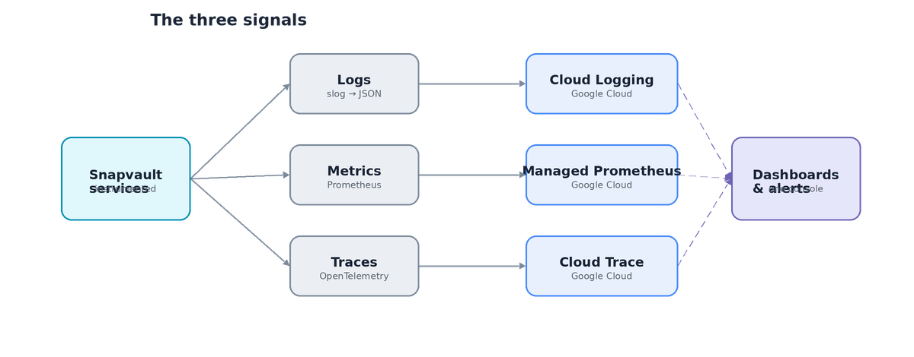

# Chapter 13 --- Observability: Logs, Metrics, and Traces

Snapvault now runs on a self-healing cluster, provisioned from code. But ask a simple question --- "a user uploaded a photo thirty seconds ago and it still isn't in their feed; why?" --- and the system has no answer for you. Was the upload slow, or did it fail? Did the `images.uploaded` event get published? Did the thumbnailer pick it up, or is it backed up? Did the feed consumer choke on the message? In a monolith you'd attach a debugger or read one log file. In a distributed system spread across five services and an asynchronous broker, that single question crosses four processes and a message queue, and "read the logs" means reading four sets of logs and correlating them by hand.

Observability is the property of being able to answer questions like that about a running system without shipping new code to investigate. It rests on three kinds of telemetry, often called the three pillars: **logs** (discrete events --- "this happened"), **metrics** (aggregate numbers over time --- "how many, how fast"), and **traces** (the path of a single request as it moves through services --- "where did the time go, and where did it break"). This chapter gives Snapvault all three and pipes them into Google Cloud's Logging, Monitoring, and Trace, so the upload question becomes a thirty-second investigation instead of an afternoon.



## Logs: structured already, correlated next

We did the hard part of logging in Chapter 2. Every service emits structured JSON to stdout through `slog`, tagged with the service name. That choice pays off immediately on GKE: anything a container writes to stdout is automatically collected by Cloud Logging, parsed as JSON, and made queryable --- no logging agent to install, no log files to rotate. You can already filter the cluster's logs to `jsonPayload.service="thumbnails"` and `severity>=ERROR` in the Cloud console. Writing to stdout was the entire integration.

What structured logs still lack is a way to stitch one request's log lines together across services. When the gateway logs "proxying upload," the images service logs "stored original," and the feed service logs "added item," nothing connects those three lines as belonging to the *same* upload. The fix is a **correlation ID**: a unique value generated at the edge and carried through every hop, attached to every log line. Add a small middleware to `internal/platform/httpx`:

``` go
package httpx

import (
    "context"
    "crypto/rand"
    "encoding/hex"
    "log/slog"
    "net/http"
)

type ctxKey string

const requestIDKey ctxKey = "request_id"

// RequestID ensures every request has an ID (reusing an inbound
// X-Request-Id if present), stores it on the context, and echoes it back.
func RequestID(next http.Handler) http.Handler {
    return http.HandlerFunc(func(w http.ResponseWriter, r *http.Request) {
        id := r.Header.Get("X-Request-Id")
        if id == "" {
            b := make([]byte, 8)
            _, _ = rand.Read(b)
            id = hex.EncodeToString(b)
        }
        ctx := context.WithValue(r.Context(), requestIDKey, id)
        w.Header().Set("X-Request-Id", id)
        next.ServeHTTP(w, r.WithContext(ctx))
    })
}

// LoggerFrom returns a logger pre-tagged with the request ID on ctx.
func LoggerFrom(ctx context.Context, base *slog.Logger) *slog.Logger {
    if id, ok := ctx.Value(requestIDKey).(string); ok {
        return base.With("request_id", id)
    }
    return base
}
```

The gateway generates the ID and forwards it as the `X-Request-Id` header on its proxied calls; downstream services reuse it. Every handler logs through `httpx.LoggerFrom(r.Context(), log)`, so a single Cloud Logging query on `jsonPayload.request_id` returns the whole story of one upload across all the synchronous hops. We'll do even better for the asynchronous hops with tracing, where the trace ID plays the same role automatically.

## Metrics: RED for services, depth for the worker

Logs tell you about individual events; metrics tell you about the system in aggregate. The most useful starting set for a request-serving service is **RED**: **R**ate (requests per second), **E**rrors (how many failed), and **D**uration (how long they took). All three fall out of one histogram if you record every request's latency labelled by route and status. Use the Prometheus client library. Add `internal/platform/metrics`:

``` go
package metrics

import (
    "net/http"
    "strconv"
    "time"

    "github.com/prometheus/client_golang/prometheus"
    "github.com/prometheus/client_golang/prometheus/promauto"
    "github.com/prometheus/client_golang/prometheus/promhttp"
)

var httpDuration = promauto.NewHistogramVec(
    prometheus.HistogramOpts{
        Name:    "http_request_duration_seconds",
        Help:    "Latency of HTTP requests.",
        Buckets: prometheus.DefBuckets,
    },
    []string{"route", "method", "status"},
)

// Middleware records rate, errors, and duration for every request.
func Middleware(next http.Handler) http.Handler {
    return http.HandlerFunc(func(w http.ResponseWriter, r *http.Request) {
        rec := &statusRecorder{ResponseWriter: w, status: 200}
        start := time.Now()
        next.ServeHTTP(rec, r)
        httpDuration.WithLabelValues(
            routeOf(r), r.Method, strconv.Itoa(rec.status),
        ).Observe(time.Since(start).Seconds())
    })
}

// Handler serves the Prometheus exposition endpoint.
func Handler() http.Handler { return promhttp.Handler() }

type statusRecorder struct {
    http.ResponseWriter
    status int
}

func (s *statusRecorder) WriteHeader(c int) {
    s.status = c
    s.ResponseWriter.WriteHeader(c)
}
```

`routeOf` returns the matched pattern (`/images/{name}`, not `/images/abc123`) so that high-cardinality IDs don't explode into thousands of distinct metric series --- a classic and expensive mistake. Since Go 1.23, `ServeMux` records the pattern it matched in `r.Pattern`, so the helper is three lines:

``` go
func routeOf(r *http.Request) string {
    if r.Pattern != "" {
        return r.Pattern
    }
    return "unmatched" // a 404: never label by the raw path
}
```

It works only because the middleware wraps the mux directly and reads `r.Pattern` *after* the mux has served the request. Each HTTP service wraps its mux with `metrics.Middleware` and serves `metrics.Handler()` at `/metrics`. The error rate and request rate are both derivable from the histogram's count, and latency percentiles from its buckets --- three signals from one instrument.

The thumbnails worker has no requests to count, but it has the metric that matters most for a queue-based system: how much work is waiting. Expose the consumer's pending count and the time each resize takes:

``` go
var (
    thumbsProcessed = promauto.NewCounter(prometheus.CounterOpts{
        Name: "thumbnails_processed_total",
        Help: "Thumbnails successfully generated.",
    })
    thumbDuration = promauto.NewHistogram(prometheus.HistogramOpts{
        Name: "thumbnail_seconds",
        Help: "Time to resize one image.",
    })
)
```

The worker increments `thumbsProcessed` on each success and observes `thumbDuration` around the resize. The other number that matters for a queue-based system is **queue depth** --- JetStream's count of messages waiting for the `thumbnailer` consumer. A deep, growing backlog means the workers can't keep up. You can read it any time with `nats consumer info IMAGES thumbnailer` (the "Unprocessed Messages" line). To graph and alert on it, run the official **prometheus-nats-exporter** next to the NATS server: it scrapes the server's monitoring endpoint and exposes per-consumer pending counts as Prometheus metrics, which Managed Prometheus collects like any other. Chapter 14 discusses scaling on it.

On GKE, **Google Managed Service for Prometheus** scrapes these `/metrics` endpoints for you --- no Prometheus server to run. You point it at your Pods with a `PodMonitoring` resource. One covers the four HTTP services, which serve `/metrics` on their main port:

``` yaml
apiVersion: monitoring.googleapis.com/v1
kind: PodMonitoring
metadata:
  name: snapvault-http
spec:
  selector:
    matchExpressions:
      - { key: app, operator: In, values: [gateway, images, metadata, feed] }
  endpoints:
    - port: 8080
      path: /metrics
      interval: 30s
```

A second, identical but for `matchLabels: { app: thumbnails }` and `port: 8081`, covers the worker, which serves `/metrics` next to its health endpoints. Both live in the base, beside the Deployments they watch.

The scraped series land in Cloud Monitoring, where you build dashboards and alerts --- "error rate above 1% for five minutes," "p99 latency over a second" --- on the RED metrics every service now emits.

## Traces: following one request across the gap

A trace is the killer feature for microservices, because it's the one tool that natively understands "this work spanned several services." A trace is a tree of **spans**, each a timed operation, linked by a shared **trace ID** that propagates from service to service. Render it and you see, for one upload, the gateway span containing the images span containing the GCS write --- and, critically, the asynchronous thumbnailing that happened later, linked back to the same trace. The time spent in each hop is right there; so is the hop that failed.

We use **OpenTelemetry**, the vendor-neutral standard, and export to **Cloud Trace**. Initialize a tracer provider once at startup in `internal/platform/telemetry`:

``` go
package telemetry

import (
    "context"

    texporter "github.com/GoogleCloudPlatform/opentelemetry-operations-go/exporter/trace"
    "go.opentelemetry.io/otel"
    "go.opentelemetry.io/otel/propagation"
    sdktrace "go.opentelemetry.io/otel/sdk/trace"
)

// Init installs the W3C propagator and, when projectID is set, a Cloud Trace
// exporter. With no project (local development) it leaves the global no-op
// tracer in place, so the same binary runs without Google Cloud credentials.
// The returned func flushes spans on shutdown.
func Init(ctx context.Context, projectID string) (func(context.Context) error, error) {
    otel.SetTextMapPropagator(propagation.TraceContext{})

    if projectID == "" {
        return func(context.Context) error { return nil }, nil
    }

    exp, err := texporter.New(texporter.WithProjectID(projectID))
    if err != nil {
        return nil, err
    }
    tp := sdktrace.NewTracerProvider(
        sdktrace.WithBatcher(exp),
        sdktrace.WithSampler(sdktrace.ParentBased(sdktrace.TraceIDRatioBased(0.1))),
    )
    otel.SetTracerProvider(tp)
    return tp.Shutdown, nil
}
```

Each service calls it first thing in `main`, with `telemetry.Init(ctx, config.String("GOOGLE_CLOUD_PROJECT", ""))`, and exits if it returns an error. The prod overlay sets `GOOGLE_CLOUD_PROJECT` in the ConfigMap; forget it and nothing fails --- the services just run without exporting a single span. The empty-project branch matters more than it looks. Without it, `texporter.New` would try to discover a project from the environment, fail on a laptop with no Google Cloud credentials, and take every service in your Compose stack down at startup. In the cluster, set `GOOGLE_CLOUD_PROJECT` and the exporter switches on; the runtime service account needs `roles/cloudtrace.agent` to write spans.

The sampler keeps 10% of traces (`TraceIDRatioBased(0.1)`) but, because it's `ParentBased`, always keeps a trace whole --- if the gateway decided to sample a request, every downstream span for it is kept too. Setting the `TraceContext` propagator tells OpenTelemetry to read and write the W3C `traceparent` header.

For HTTP, instrumentation is nearly free: wrap each service's handler with `otelhttp`, and wrap the gateway's outbound proxy transport, and the trace context flows over the wire automatically:

``` go
import "go.opentelemetry.io/contrib/instrumentation/net/http/otelhttp"

handler := otelhttp.NewHandler(mux, "snapvault")
// and on the client side the gateway uses:
//   client := &http.Client{Transport: otelhttp.NewTransport(http.DefaultTransport)}
```

That covers gateway → images → metadata → feed. The interesting part --- the part most tracing setups get wrong --- is the asynchronous hop. When images publishes `images.uploaded` and the thumbnailer consumes it later, in a different process, the trace must survive the trip through NATS. It does, if we inject the trace context into the message's headers on publish and extract it on consume. NATS messages carry headers (`nats.Header`, a `map[string][]string`), which is exactly what a propagation carrier needs. Write a tiny adapter:

``` go
package telemetry

import "github.com/nats-io/nats.go"

// NatsHeaderCarrier adapts NATS message headers to OpenTelemetry's
// TextMapCarrier so trace context survives a publish/consume round trip.
type NatsHeaderCarrier nats.Header

func (c NatsHeaderCarrier) Get(key string) string { return nats.Header(c).Get(key) }
func (c NatsHeaderCarrier) Set(key, val string)   { nats.Header(c).Set(key, val) }
func (c NatsHeaderCarrier) Keys() []string {
    keys := make([]string, 0, len(c))
    for k := range c {
        keys = append(keys, k)
    }
    return keys
}
```

On the publish side, images injects the current context into a header-bearing message:

``` go
msg := &nats.Msg{Subject: events.SubjectUploaded, Header: nats.Header{}, Data: payload}
otel.GetTextMapPropagator().Inject(ctx, telemetry.NatsHeaderCarrier(msg.Header))
// publish msg via JetStream
```

On the consume side, the thumbnailer extracts it before starting its own span, so the resize work attaches to the original upload's trace even though minutes and a process boundary separate them:

``` go
ctx := otel.GetTextMapPropagator().Extract(
    context.Background(), telemetry.NatsHeaderCarrier(msg.Headers()),
)
ctx, span := otel.Tracer("thumbnails").Start(ctx, "generate thumbnail")
defer span.End()
// ... resize, upload, publish images.thumbnailed (injecting ctx again) ...
```

The metadata and feed consumers do the same, each starting a span of its own around the database write. Without that span the extracted context would still be passed along, but nothing in those services would appear in the trace.

Now Cloud Trace shows a single upload as one connected tree: the synchronous gateway-to-images leg, then --- linked, not orphaned --- the thumbnailer's work and the feed update that followed. The gap that asynchronous messaging opens for observability is closed.

::: tip
The trace ID is the correlation ID we built by hand at the start of this chapter, only better --- OpenTelemetry generates and propagates it for you, across both HTTP and NATS. Add the active trace ID to your `slog` records (pull it from the span context) and your logs and traces link automatically: click a slow span in Cloud Trace, jump to the exact log lines for that request in Cloud Logging. Logs, metrics, and traces stop being three separate tools and become three views of one event.
:::

## What this buys you

Return to the opening question: an upload from thirty seconds ago isn't in the feed. With observability in place, you open Cloud Trace, find the trace by the user or time, and read the tree. Maybe the images span is fine and the thumbnailer span never started --- the metric for queue depth confirms a backlog, and you scale the worker. Maybe the feed consumer span shows an error --- its correlated log line shows a Postgres timeout. Either way you've gone from "the system is a black box" to a specific, evidence-backed answer in the time it took to read this paragraph. That is the entire point: not telemetry for its own sake, but the ability to ask the running system what it's doing and get a straight answer.

### Summary

-   **Observability** is answering questions about a running system without shipping new code to investigate, built on three pillars: **logs**, **metrics**, and **traces**.
-   Structured `slog` JSON to stdout (from Chapter 2) is **auto-ingested by Cloud Logging** on GKE; a **correlation ID** middleware stitches one request's log lines across synchronous hops.
-   **RED metrics** (rate, errors, duration) for HTTP services come from a single latency histogram labelled by *matched route* --- never raw IDs, which explode cardinality.
-   The worker's key metric is **queue depth** (JetStream's pending count), visible with `nats consumer info` and exportable to Prometheus with the NATS exporter.
-   **Google Managed Service for Prometheus** scrapes `/metrics` via a `PodMonitoring` resource --- no Prometheus server to operate.
-   **OpenTelemetry** traces follow one request as a tree of spans sharing a **trace ID**; `otelhttp` propagates context over HTTP almost for free.
-   The asynchronous hop is preserved by **injecting trace context into NATS message headers** on publish and **extracting** it on consume --- the detail that makes distributed tracing actually work across a broker.
-   Put the trace ID on your log records and **logs, metrics, and traces become three views of one event**, all flowing into Cloud Logging, Monitoring, and Trace.

We can finally see what Snapvault is doing. The last chapter uses that visibility to harden the system for real traffic: autoscaling on the signals we now collect, real secret management, a resilient broker and resilient services, and the gateway aggregation we've deferred since Chapter 4.
